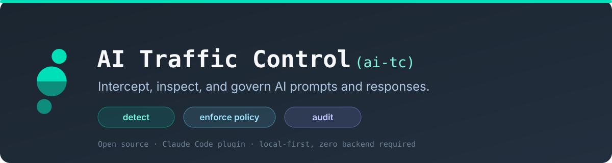

<p align="center"></p>

# AI Traffic Control

**AKA Security — We secure agent harnesses at the source.**

AI Traffic Control (`ai-tc`) is an open-source control plane for coding agents. It watches an agent session's traffic (prompts, tool calls, responses, file reads), scans each event against your rule packs, and decides what happens next: monitor, warn, redact, block, or a manual exception. Secrets and regulated data like PCI, PHI, and PII are caught locally: live detection and enforcement never send them to a model or a third party. The one exception is the opt-in `/aka:setup` calibration, which does send what its history scan finds to the model API to be rated.[^egress]


[](https://akasecurity.io)

`ai-tc` works standalone, and governs what a session carries: rule packs, findings, policy, and an audit trail, across Claude Code and Claude Desktop. To harden the harness itself — safe-default permissions, structural command guards, and credential deny rules for Claude Code — pair it with [claude-tools](https://github.com/akasecurity/claude-tools). They compose: claude-tools hardens the harness, `ai-tc` governs the traffic.

## How it works

Every event in a session runs through one control point before it takes effect:

```
prompt · tool call · response · file read   →   ai-tc policy engine   →   monitor · warn · redact · block · exception
```

Prompts and tool inputs are checked before they reach the model; tool outputs and file reads are checked after it responds. Each event is scanned against your installed rule packs, every match becomes a finding (rule id, category, severity, matched span), and policy decides the outcome. Everything is logged.

Detection is mostly regex, patterns shaped like an AWS access key, an email address, or a bank routing number, which covers most secrets and PII since they have a predictable shape. A smaller set of rules match on keyword, and some regex matches run through a validator, such as a Luhn checksum for card numbers or a Shannon-entropy check for high-entropy secrets, to cut false positives.

### Policy outcomes

A finding resolves to one of five outcomes:

| Outcome       | What happens                                                                                                       |
| ------------- | ------------------------------------------------------------------------------------------------------------------ |
| **Monitor**   | Logged only. Most rules ship here; on a new install the vendor-key secrets and risky-command packs start on warn.  |
| **Warn**      | Surfaces a warning in the session; the content still goes through unchanged.                                       |
| **Redact**    | The matched value is replaced in place before it reaches the model. Tool inputs and outputs only, not prompt text. |
| **Block**     | The prompt or tool call is stopped, with a message explaining what fired.                                          |
| **Exception** | A manually granted, exact-value override that lets one specific match through despite its rule's policy.           |

Promote any detection from monitor to warn, redact, or block from the dashboard, per rule or per category.

Those two warn defaults apply only when a pack is first installed. Upgrading an existing install does not assign them: the packs stay unassigned and follow your category settings, which are on monitor unless you changed them.

## Key concepts

| Term          | What it is                                                                                           |
| ------------- | ---------------------------------------------------------------------------------------------------- |
| **Event**     | A prompt, response, tool call, or file read captured from an agent session.                          |
| **Finding**   | A rule match produced by the detection engine against an event.                                      |
| **Rule**      | A JSON file describing what to detect: a keyword list, a regex pattern, or a validator.              |
| **Rule pack** | A directory of rules and their fixtures with a `manifest.json`.                                      |
| **Policy**    | The decision about what to do when a rule or category fires.                                         |
| **Plugin**    | The harness extension that intercepts sessions. One package, used by Claude Code and Claude Desktop. |

## Where your data lives

`ai-tc` keeps what it records in a local SQLite store at `~/.aka/data/aka.db`, with your settings beside it under `~/.aka/settings`. There is no database server to run and no schema to manage — the CLI, the plugin, and the dashboard all read and write that one file.

That store is a running log of your agent sessions: prompts, responses, tool calls. What gets masked in it follows the policy assigned to the detection that flagged the span: a flagged span is masked at rest only where that policy is redact or block. Under monitor or warn the value is stored as it was seen, and everything outside a flagged span is stored verbatim and unencrypted either way. No detection ships on redact or block, so on a default install nothing is masked at all and `aka.db` builds up a full local record of what your agent saw, raw secrets included; promoting a detection changes what is stored from then on, not what is already there. Files read by `aka scan` are stored under the same rule. On macOS and Linux the store directories are created owner-only (`0700`) and the files are written `0600`. Those permissions are the only at-rest control there is, and they do nothing on Windows.

That stored content is also what an attached machine sends. `aka attach` registers a machine against a control plane your organization runs — not a service AKA operates — and from then on this machine forwards each captured event to that deployment as it stored it, so the masking rule above is also the rule for what crosses the network: under monitor or warn the matched value reaches that deployment unmasked, and promoting the detection to redact or block masks it before it is stored and so before it is sent. No detection ships on redact or block, so on an attached machine that is the default posture rather than an edge case. A machine attached with `aka attach --scoped`, as a personal device usually is, forwards activity only from the repositories enrolled with `aka enroll`, from Claude Code and Codex sessions signed in to a recognised work subscription or to an account enrolled by hand with `aka enroll --account` and, from the browser extension, only the replies in a claude.ai account enrolled with `aka enroll --account`, with their tool calls and token usage (a prompt typed into a web chat is not recorded there at all); everything else stays local, and the policy pull, the sighting-key fetch, the command check and the device report are not limited to what is enrolled. A Claude Code session counts as a work subscription when it is signed in through claude.ai to a Team or Enterprise plan under the same email as the AKA account that attached the device. Such a session sends everything it records from its first reply on, from any folder, with that folder's project and branch names, and your organization's prohibited models are refused in any folder of it. To tell whether a session is one, the device reads Claude Code's login file, the session's own log, and Claude Code's settings files (the project's own included) and environment variables that choose the account or provider, and compares the signed-in email with the account that attached the device. The check sends none of what it reads, though the token usage and tool calls read from that same log are forwarded with the rest of the activity of a recognised session or of one signed in to an account enrolled by hand. The first prompt of a new session, a personal plan, another email, an API key or another provider, a reply written before the device has confirmed the account, and the rest of a session whose organization changes follow the repository rule; `aka enroll --account` enrolls by hand an account the device cannot recognise, and the Claude Code sessions of an account enrolled that way then forward from their first reply on whatever the plan or email, though not under an API key or another provider. An organization recognised this way never records or forwards a claude.ai chat. A personal device that attached before its plugin could recognise work subscriptions starts recognising them when the plugin updates, with no new prompt, so update `aka` first. `aka unenroll --work-subscriptions` turns recognition off on this device and `aka enroll --work-subscriptions` turns it back on; it turns off only the automatic recognition, so while it is off, enrolled repositories and accounts enrolled by hand still forward (`aka unenroll --account` stops an account), and your organization's model restrictions apply only to them. A machine whose connection an administrator manages attaches machine-wide only, so it has no personal-device mode and no such opt-out. A Codex thread counts as a work subscription when it is new and signed in with ChatGPT to a Business, Team, Enterprise or Edu workspace under the same email as the AKA account that attached the device, with its login saved in Codex's login file and OpenAI as the provider. Such a thread sends everything it records, from any folder, with that folder's project and branch names, and your organization's prohibited models are refused in any folder of it. To tell whether a thread is one, the device reads Codex's login file, the first line of the thread's own log and the environment variables that choose the account or provider, and compares the signed-in email with the account that attached the device and the login's workspace with the one that created the thread. The check sends none of what it reads, though the token usage and tool calls read from that thread's log are forwarded with the rest of the activity of a recognised thread or of one signed in to a workspace enrolled by hand. A token refresh keeps a recognised thread forwarding; a switch to another workspace or email, to a plan that does not count, or to another login mode ends it for the rest of that thread. A resumed thread, a personal plan, a service account, another email, a saved login that uses an API key or any login mode other than ChatGPT, a `CODEX_API_KEY` or `CODEX_ACCESS_TOKEN` in the environment, an `OPENAI_BASE_URL` naming a host other than api.openai.com, a thread whose log does not name OpenAI as its provider or the login's workspace as its creator, and a login Codex keeps outside its login file (in the system keychain, for one) follow the repository rule. A Codex thread whose first log line is not on disk when it starts is checked again at its next prompt or tool call: its session record and the token usage and tool calls read from its log follow the repository rule, and its prompts, tool calls and results forward from any folder from that check on if the workspace is then recognised or enrolled by hand; if the line is still missing then, it follows the repository rule for the rest of the thread. `aka enroll --account` enrolls by hand a workspace the device cannot recognise, and the Codex threads of a workspace enrolled that way then forward whatever the plan or email, though not a resumed thread, one whose saved login uses an API key or any login mode other than ChatGPT, one with a `CODEX_API_KEY` or `CODEX_ACCESS_TOKEN` in the environment, one with an `OPENAI_BASE_URL` naming a host other than api.openai.com, one whose log does not name OpenAI as its provider, or one whose login Codex keeps outside its login file; a switch of workspace or login mode ends them. `aka unenroll --work-subscriptions` turns the recognition of Codex threads off too and `aka enroll --work-subscriptions` turns it back on; a workspace enrolled by hand still forwards while it is off (`aka unenroll --account` stops it). Whenever a session starts anywhere on this machine, in a repository or not (a browser chat included), the machine pulls the deployment's policy (at most every 15 minutes) and its sighting key (when none is stored or the stored one is a day old) and sends it a device report (at most hourly): a device identifier, host name, versions, detection packs, policy counts, finding counts and dates for everything recorded on the machine, and, when the machine is attached as a personal device, the fact that it is one. Where a scan is available (the coding-agent plugins, not a browser chat), the same session start also checks it for device commands. On a personal device, the background sync also asks the deployment which account its key belongs to, and asks again at later syncs until the device has an answer; syncs that overlap can each send one. On a machine attached machine-wide, a Claude Code session start also sends the Claude Code configuration that session's scan found: each skill, hook, MCP server and configuration file, with its name, scope, file path and the plugin or marketplace it came from; a skill's description, version and modification time; a hook's event, matcher, command and timeout, and an MCP server's transport and command or URL, each description, command and URL with any secret the bundled detection rules find masked, and an MCP server's URL also stripped of its credentials and query values; the names of an MCP server's environment variables, never their values; a configuration file's kind, modification time and a summary of its shape (key names, line and entry counts), never its contents; and the repository's remote URL with any credentials and query removed, or the working directory where it has none, that the project's own items belong to. A machine attached with `--scoped` keeps this configuration on the machine. The deployment therefore learns when the tool is in use anywhere on this machine. A machine you have not attached forwards none of this.[^egress]

**[SECURITY.md](SECURITY.md)** has the full picture — every file the store spans, what an attached machine forwards, what to do on Windows, and how to report a vulnerability.

## Install

`ai-tc` installs as a plugin through the AKA marketplace. The `aka` CLI installs on its own, with or without a coding agent.

### Claude Code

In Claude Code:

```bash
/plugin marketplace add akasecurity/marketplace
/plugin install ai-tc@akasecurity
```

### Claude Desktop

Claude Desktop is supported too; the [installation guide](https://akasecurity.github.io/ai-tc-docs/getting-started/installation/) covers both. `ai-tc` runs locally alongside your agent. Standalone by default: there's no backend to stand up, and no scanning happens off your machine.[^egress]

### The `aka` CLI (standalone binary)

The CLI carries the dashboard, the local store and `aka scan`. The binary embeds its own runtime, so it needs no Node.js.

macOS / Linux, with [Homebrew](https://brew.sh):

```bash
brew install akasecurity/tap/aka
```

Windows, with [Scoop](https://scoop.sh):

```powershell
scoop bucket add akasecurity https://github.com/akasecurity/scoop-bucket
scoop install aka
# or, without adding the bucket:
scoop install https://github.com/akasecurity/ai-tc/releases/download/bin-latest/aka.json
```

Or the bootstrap installer, which downloads the same archive:

```bash
# macOS / Linux
curl -fsSL https://raw.githubusercontent.com/akasecurity/ai-tc/bin-latest/tools/installer/install.sh | sh

# Windows (PowerShell)
irm https://raw.githubusercontent.com/akasecurity/ai-tc/bin-latest/tools/installer/install.ps1 | iex
```

Or download an archive directly — these four links always serve the newest binary release. The binary is ad-hoc signed and not notarized, so a browser download is quarantined and Gatekeeper refuses to run it, while `brew`, `curl` and command-line `tar` don't quarantine what they fetch.

| Platform              | Download                                                                                                             |
| --------------------- | -------------------------------------------------------------------------------------------------------------------- |
| macOS (Apple silicon) | [aka-darwin-arm64.tar.gz](https://github.com/akasecurity/ai-tc/releases/download/bin-latest/aka-darwin-arm64.tar.gz) |
| Linux x64             | [aka-linux-x64.tar.gz](https://github.com/akasecurity/ai-tc/releases/download/bin-latest/aka-linux-x64.tar.gz)       |
| Linux arm64           | [aka-linux-arm64.tar.gz](https://github.com/akasecurity/ai-tc/releases/download/bin-latest/aka-linux-arm64.tar.gz)   |
| Windows x64           | [aka-win32-x64.zip](https://github.com/akasecurity/ai-tc/releases/download/bin-latest/aka-win32-x64.zip)             |

Intel macOS (`darwin-x64`) has no binary build — install the CLI from npm there instead: `npm install -g @akasecurity/cli` (needs Node.js 24+).

Each archive extracts to its own `aka-<platform>-<arch>/` directory; the binary has to stay inside it to find the files it loads at startup. Then run `aka init`.

Check a download against [SHA256SUMS](https://github.com/akasecurity/ai-tc/releases/download/bin-latest/SHA256SUMS) and its build provenance with `gh attestation verify` — [tools/installer/README.md](tools/installer/README.md) sets out the trust chain and what each check does and does not establish. The Homebrew tap and Scoop bucket entries above are published by each binary release.

Upgrade the way you installed: `brew upgrade aka`, `scoop update aka`, or re-run the one-liner.

[^egress]: Detection and enforcement run locally — no AKA server and no account unless you attach to one. Four narrow paths can reach the network. Three of them are child processes: the passive **update notice**, which is on by default and needs no command — after a run, when stdout is a terminal, a stale cache makes `aka` look up three package versions with `npm view` (`--no-update-check` skips it, and `cli/README.md` details what the registry learns); package-manager installs/updates (`npm`/`claude`/`codex`); and the **opt-in** `/aka:setup` calibration. That last one is the only one of those three that carries your data, and the only path anywhere that sends it to a model: to rate false positives and severity, its judge step sends what an initial history scan finds — for each finding, the raw unmasked value including any secret, roughly 120 characters of the surrounding transcript text on either side (re-scanned before it goes, so every secret the rules detect in that window is masked, including the finding's own value where it appears there), the finding's rule, category, severity, masked value and confidence, and a sequential counter the model echoes back so its verdict can be matched to the finding — to the model API through the `claude` CLI. The source file's path is not sent. That's the same model provider your agent already uses, reached with your own credentials, and it takes **two** separate opt-ins: one to read your history at all, and a second, distinct grant to send what was found. Without that second grant the judge does not run. Each is revocable on its own under the dashboard's Settings, which stops future scans — data already sent cannot be recalled. The fourth is **opt-in and off unless you turn it on**, and it is the other path that carries your data: `aka attach` registers this machine against an AKA deployment your organization runs, after which the plugin forwards the activity that deployment is entitled to see and pulls the policy it sets. That covers activity from the moment you attach. On a machine attached with `aka attach --scoped`, what this path forwards of the machine's activity, the history and the scan register described below included, is limited to the repositories enrolled with `aka enroll` (`aka enroll --list` shows them and `aka unenroll` takes one out), to Claude Code and Codex sessions signed in to a recognised work subscription or to an account enrolled by hand with `aka enroll --account` and, from the browser extension, to the replies in a claude.ai account enrolled with `aka enroll --account`, with their tool calls and token usage — a prompt typed into a web chat is not recorded there at all — and everything else stays on the machine; under the history opt-in described next, enrolling a repository or an account also queues the captures still kept for it, and enrolling a repository sends its activity from before the attachment, while what that repository recorded between attaching and enrolling, other than those captures and what a Claude Code or Codex session of a recognised work subscription or of an account enrolled by hand there already sent, stays local. A Claude Code session counts as a work subscription when it is signed in through claude.ai to a Team or Enterprise plan under the same email as the AKA account that attached the device. Such a session sends everything it records from its first reply on, from any folder, with that folder's project and branch names, and your organization's prohibited models are refused in any folder of it. To tell whether a session is one, the device reads Claude Code's login file, the session's own log, and Claude Code's settings files (the project's own included) and environment variables that choose the account or provider, and compares the signed-in email with the account that attached the device. The check sends none of what it reads, though the token usage and tool calls read from that same log are forwarded with the rest of the activity of a recognised session or of one signed in to an account enrolled by hand. The first prompt of a new session, a personal plan, another email, an API key or another provider, a reply written before the device has confirmed the account, and the rest of a session whose organization changes follow the repository rule; `aka enroll --account` enrolls by hand an account the device cannot recognise, and the Claude Code sessions of an account enrolled that way then forward from their first reply on whatever the plan or email, though not under an API key or another provider. An organization recognised this way never records or forwards a claude.ai chat. A personal device that attached before its plugin could recognise work subscriptions starts recognising them when the plugin updates, with no new prompt, so update `aka` first. `aka unenroll --work-subscriptions` turns recognition off on this device and `aka enroll --work-subscriptions` turns it back on; it turns off only the automatic recognition, so while it is off, enrolled repositories and accounts enrolled by hand still forward (`aka unenroll --account` stops an account), and your organization's model restrictions apply only to them. A machine whose connection an administrator manages attaches machine-wide only, so it has no personal-device mode and no such opt-out. A Codex thread counts as a work subscription when it is new and signed in with ChatGPT to a Business, Team, Enterprise or Edu workspace under the same email as the AKA account that attached the device, with its login saved in Codex's login file and OpenAI as the provider. Such a thread sends everything it records, from any folder, with that folder's project and branch names, and your organization's prohibited models are refused in any folder of it. To tell whether a thread is one, the device reads Codex's login file, the first line of the thread's own log and the environment variables that choose the account or provider, and compares the signed-in email with the account that attached the device and the login's workspace with the one that created the thread. The check sends none of what it reads, though the token usage and tool calls read from that thread's log are forwarded with the rest of the activity of a recognised thread or of one signed in to a workspace enrolled by hand. A token refresh keeps a recognised thread forwarding; a switch to another workspace or email, to a plan that does not count, or to another login mode ends it for the rest of that thread. A resumed thread, a personal plan, a service account, another email, a saved login that uses an API key or any login mode other than ChatGPT, a `CODEX_API_KEY` or `CODEX_ACCESS_TOKEN` in the environment, an `OPENAI_BASE_URL` naming a host other than api.openai.com, a thread whose log does not name OpenAI as its provider or the login's workspace as its creator, and a login Codex keeps outside its login file (in the system keychain, for one) follow the repository rule. A Codex thread whose first log line is not on disk when it starts is checked again at its next prompt or tool call: its session record and the token usage and tool calls read from its log follow the repository rule, and its prompts, tool calls and results forward from any folder from that check on if the workspace is then recognised or enrolled by hand; if the line is still missing then, it follows the repository rule for the rest of the thread. `aka enroll --account` enrolls by hand a workspace the device cannot recognise, and the Codex threads of a workspace enrolled that way then forward whatever the plan or email, though not a resumed thread, one whose saved login uses an API key or any login mode other than ChatGPT, one with a `CODEX_API_KEY` or `CODEX_ACCESS_TOKEN` in the environment, one with an `OPENAI_BASE_URL` naming a host other than api.openai.com, one whose log does not name OpenAI as its provider, or one whose login Codex keeps outside its login file; a switch of workspace or login mode ends them. `aka unenroll --work-subscriptions` turns the recognition of Codex threads off too and `aka enroll --work-subscriptions` turns it back on; a workspace enrolled by hand still forwards while it is off (`aka unenroll --account` stops it). Attached either way, the machine sends more than activity, and no repository limits it. Whenever a session starts anywhere on this machine, in a repository or not (a browser chat included), the machine pulls the deployment's policy (at most every 15 minutes) and its sighting key (when none is stored or the stored one is a day old) and sends it a device report (at most hourly): a device identifier, host name, versions, detection packs, policy counts, finding counts and dates for everything recorded on the machine, and, when the machine is attached as a personal device, the fact that it is one. Where a scan is available (the coding-agent plugins, not a browser chat), the same session start also checks it for device commands. On a personal device, the background sync also asks the deployment which account its key belongs to, and asks again at later syncs until the device has an answer; syncs that overlap can each send one. On a machine attached machine-wide, a Claude Code session start also sends the Claude Code configuration that session's scan found: each skill, hook, MCP server and configuration file, with its name, scope, file path and the plugin or marketplace it came from; a skill's description, version and modification time; a hook's event, matcher, command and timeout, and an MCP server's transport and command or URL, each description, command and URL with any secret the bundled detection rules find masked, and an MCP server's URL also stripped of its credentials and query values; the names of an MCP server's environment variables, never their values; a configuration file's kind, modification time and a summary of its shape (key names, line and entry counts), never its contents; and the repository's remote URL with any credentials and query removed, or the working directory where it has none, that the project's own items belong to. A machine attached with `--scoped` keeps this configuration on the machine. The deployment therefore learns when the tool is in use anywhere on this machine. What this machine recorded BEFORE the attachment is a **separate opt-in**: `aka attach` asks about it once, it defaults to no, and `aka sync-history --on`/`--off` changes the answer later. It covers the activity already recorded BEFORE the attachment: which sessions ran and when, in which project, repo and branch, token usage and model per call, which tools were called with their inputs truncated and every detected secret already masked, what AKA detected in those inputs, and the prompts, assistant replies and tool results themselves. For a **captured** prompt, assistant reply or tool result, what is sent **includes its text**. What is masked in that text follows the policy assigned to the detection that flagged the value, exactly as it does at rest: masked only where that policy is redact or block, and under monitor or warn the matched value crosses as it was seen, as does everything outside a flagged span. The one exception is a value a **secret**-category detection matches: whatever its policy, it is not sent as it was seen, and the copy kept on this machine is unchanged. With credential-sighting sharing off, which is the default unless the organization's managed settings require it, it leaves only as `[REDACTED:SECRET]`. With sharing on, it leaves as a sighting token instead, a keyed hash of the value under a key the deployment issues (the machine fetches that key over the same connection, whether or not sharing is on), with the detection's rule and category beside it. The deployment cannot read a value back from its token, but since it holds the key it can test a guessed value against one, so a short or predictable secret is pseudonymous to it rather than hidden. No detection ships on redact or block, so on a default install nothing else in that text is masked. The live path sends a capture the same way, and one it could not deliver at the time — the deployment was unreachable or refused the key, or the capture's secret scan did not finish within the hook's time — is kept and sent later in the background whether or not this opt-in is given. So declining does not stop activity being sent from the attachment onwards; that is part of being attached. It sends in the background over later sessions — on macOS, `aka attach` also installs a per-user LaunchAgent that re-runs the drain on its own schedule, so delivery does not depend on a session ever reopening — and what has been sent cannot be recalled. It is the one path with a network client in the source — `@akasecurity/remote`, the only package permitted to open a socket — and it does nothing until both an endpoint and an access key are on disk. Captured activity is not all it carries: a manual scan on an attached machine — `aka scan`, or the dashboard's Scan page — forwards over that same connection the Data Shares register the scan just recorded, which is the destination hosts and endpoints found in the files it walked plus the file and line of each call site, with no source text and the project key replaced by a digest; while this machine shares credential sightings, each call site also names the credentials it uses — an environment variable it reads, by name, or a secret written in it, as a keyed fingerprint, never the value; `aka scan --no-forward` skips it for one invocation, and an unattached machine forwards nothing. While this machine shares credential sightings, those scans and `/aka:scan` also send, in a request of their own, each secret the scan found, `.env` files included, as a sighting token (a keyed hash under the key the deployment issues) with its rule, the variable it is assigned to, its location class (a project file or a home dotfile), whether git tracks the file, and the project's digest and display name — never the value or a path; `--no-forward` skips that send too. `aka status` says what a machine is attached to and `aka detach` ends it, after which that deployment is sent nothing (the three child-process paths above are unaffected either way). Separately, and not one of the four: the `aka` CLI dispatches an unrecognized subcommand git-style, so `aka <name>` runs an `aka-<name>` program from your own `PATH` (POSIX only; a built-in always wins). That program is yours, not ours — `ai-tc` does not bundle, pin or verify it — so whether it reaches the network is its business, not something this project can describe.

## Docs

Full documentation, architecture, and the built-in detection catalog live at **[akasecurity.github.io/ai-tc-docs](https://akasecurity.github.io/ai-tc-docs/)**.

- [How it works](https://akasecurity.github.io/ai-tc-docs/getting-started/how-it-works/)
- [Architecture overview](https://akasecurity.github.io/ai-tc-docs/architecture/overview/)
- [Writing rules](https://akasecurity.github.io/ai-tc-docs/rules/writing-rules/)
